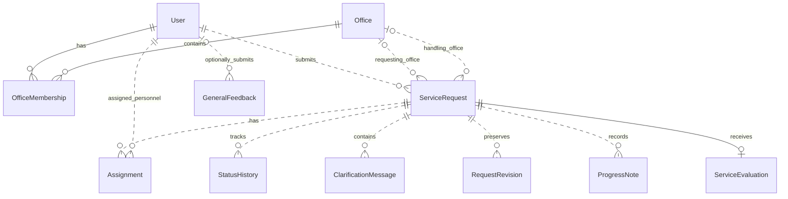
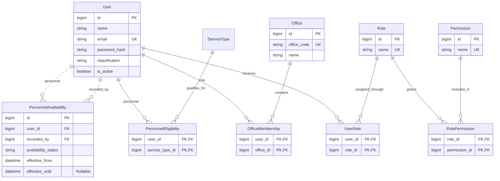
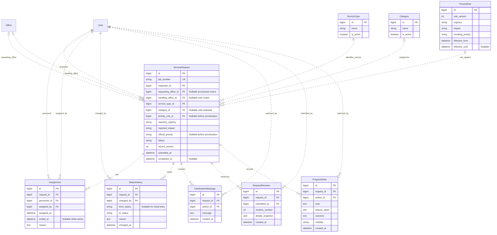
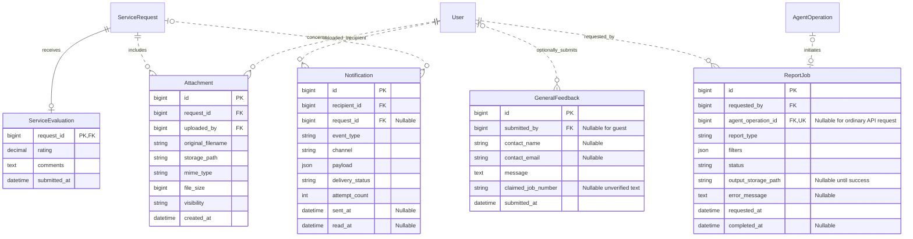
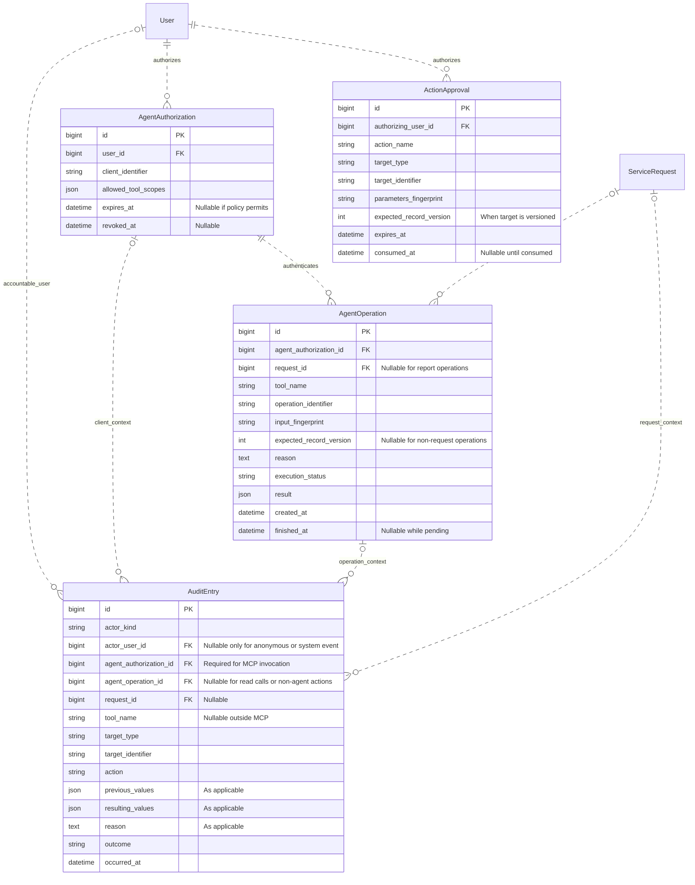

# CLSU Feedback Management System — Database Design

Status: Proposed logical database design  
Last updated: 19 October 2026.

Source: [System Architecture](system-architecture.md). This is a logical data-model proposal, not an implemented database schema. The core diagram is an overview; the full model is split into four connected diagrams for readability. Repeated entities refer to the same table. See [Database Normalization](database-normalization.md) for the normalization assessment and outstanding refinements.

## Design rationale

The following decisions support the architecture's relationship, identity, and integrity requirements.

| Design concern | Proposed approach | Architecture reference |
| --- | --- | --- |
| Complete relationship coverage | Show author, assigner, uploader, availability recorder, and approval-authorizer foreign-key relationships in the full model. | Data architecture, lines 169–180 |
| Verified evaluation ownership | Use `request_id` as the evaluation's primary/foreign key; derive the eligible evaluator from the request. The application still verifies the authenticated requester and Completed status. | Access, line 112; workflows, lines 145–146; integrity, line 180 |
| Anonymous and system audit events | Use `actor_kind`; allow `actor_user_id` to be null only for an anonymous or system event. Every MCP action must retain its authorizing user. | Public access, line 111; audit requirements, line 249 |
| Agent/client provenance | Every MCP operation references a persistent `AgentAuthorization`; MCP audit entries reference it directly, including read-tool invocations. | MCP identity, lines 188–190 and 224; audit, line 249 |
| Operation uniqueness | Enforce `UNIQUE(agent_authorization_id, tool_name, operation_identifier)` with non-null columns. The authorization ID survives network reconnects; it is not a socket/session ID. | Data integrity, line 180; execution contract, lines 224–228 |
| Identifying relationships | Use dotted, non-identifying connectors for children with independent surrogate primary keys. Composite-key junctions and the request-keyed evaluation retain identifying connectors. | ER notation convention |
| Unconfirmed implementation choices | Requesting-office nullability, eligibility by service type, and separate availability records are proposed choices rather than architecture requirements. | Access, lines 117–119; workload capability, line 197; open decisions, lines 282–286 |

The model separates general feedback from verified evaluations, distinguishes requesting and handling offices, preserves append-only operational history, permits an optional evaluation after completion, and stores file metadata for privately stored files. Audit events use `occurred_at` to identify their event timestamp.

## Notation and proposed defaults

- `PK`: primary key. `FK`: foreign key. `UK`: unique key. Composite uniqueness is specified separately where needed.
- `||`: exactly one; `o|`: zero or one; `o{`: zero or many. A dotted line does not mean the foreign key is nullable; endpoint cardinality determines optionality.
- Attribute lists show keys and important business fields, not every final migration column or common timestamp.
- Requesting office is shown as optional for a requester without an office affiliation. This is a provisional design choice requiring MISO confirmation. Handling office and category may be unset before review.
- Multiple assignment rows preserve history. These diagrams do not decide whether multiple personnel can be active simultaneously.
- Personnel eligibility by service type and a separate availability-history table are proposals, not architecture-mandated schemas.
- Roles, office memberships, and record-level policies work together. An office membership or global role alone does not grant university-wide access. Add scoped-role grant tables only if the approved authorization policy requires them.
- Guest feedback eligibility, moderation, rating scale, response targets, and allowed transitions remain subject to MISO validation.

## Core ERD

This overview deliberately omits configuration, supporting records, and secondary actor links. It is not a complete physical schema.

Each service evaluation identifies its request. Its eligible evaluator is the request's authenticated requester, so there is no second, independent evaluator relationship to contradict ownership. General feedback has no verified service-request relationship; its optional entered job number remains unverified text.

## Full ERD

### A. Organization, access, and personnel

Requester, personnel, and administrator are operational roles on the same account model. Student/faculty/staff/visitor/alumni classification does not replace authorization. An unauthenticated visitor submitting general feedback does not require a `User` row. Recorded availability does not establish physical availability.

### B. Requests, configuration, and operational history

Additional request fields remain `subject`, `location`, `affiliation`, `concern`, and `priority_exception_reason`. No service-type/category hierarchy is invented: both independently classify the request until MISO defines a relationship.

Integrity and workflow requirements:

- Generate unique job numbers with concurrency-safe sequencing or an equivalent mechanism, not a count of rows.
- Enforce `UNIQUE(request_id, revision_number)`. Preserve an initial requester snapshot and append revisions; clarification resubmission does not create another request/job number. JSON snapshots are a proposed storage choice.
- Priority-rule rows identify an immutable versioned matrix entry. For the proposed single matrix, enforce `UNIQUE(rule_version, urgency, impact)`. Future rule changes create a new version rather than overwrite historical rules. Record priority changes, selected rule, authorizing user, and exception reason in transactional audit entries. A dedicated priority-history table is optional.
- `reported_urgency` and `reported_impact` are distinct from MISO's `official_priority`. An authorized exception records its reason and does not rewrite requester statements.
- All operational changes check and increment the request's `record_version`, including assignments, clarification, notes, and transitions. Save related history and audit entries in the same transaction.
- Clarification messages in this proposal are requester-facing; internal coordination belongs in a `ProgressNote` with internal visibility.
- Allowed status values are Pending, For Clarification, Assigned, In Progress, On Hold, and Completed. Allowed transitions and prerequisites are server rules, not inferred from the ERD.
- Completion requires authorized human staff, actions taken, and an outcome. Link the completion event and its supporting note through the transactional audit evidence. An MCP tool must not complete a job.
- Keep notification dispatch after commit. Assignment history and actual transition timestamps support workload and response/resolution reporting; the ERD does not invent business-hour or deadline rules.

### C. Feedback, files, notifications, and reports

The primary key on `ServiceEvaluation.request_id` enforces at most one evaluation per request. The service must separately verify that the authenticated submitter owns the request and that its status is Completed. Neither a foreign key nor a unique key establishes those workflow conditions. Missing evaluation does not reverse completion.

`GeneralFeedback.claimed_job_number` deliberately has no foreign key to `ServiceRequest`. Guest access remains conditional on the approved public-submission policy. No rating scale, compulsory moderation table, or guest attachment feature is assumed.

This attachment model covers authenticated request attachments, as in the architecture. Store file bytes and exports privately, check record access and visibility for downloads, and do not expose internal files through guessed identifiers.

`ReportJob.agent_operation_id` is optional because people may request reports through the ordinary API. Its uniqueness permits at most one report job per report-request operation. A queued report is not ready until processing succeeds; download authorization must be checked again.

### D. MCP authorization, operation outcomes, and audit

`AgentAuthorization` represents persistent authenticated user/client authorization, not a transient network connection. Its exact implementation may use the selected Laravel token/OAuth grant model rather than a custom duplicate authentication table. Never store raw credentials in operation or audit records.

- MCP write operations require a non-null authorization reference. The authorizing user is derived from that authorization rather than accepted from the model or duplicated independently on the operation.
- Enforce `UNIQUE(agent_authorization_id, tool_name, operation_identifier)`. Keep the same authorization identity across reconnects and retries. This proposal defines caller scope as that persistent authorization grant; operation lookup remains authorized, including after token renewal mapped to the same grant.
- Identical retries return the recorded outcome; a reused identifier with a different input fingerprint fails. Check identity, permissions, office scope, and record access on outcome retrieval.
- Read-tool invocations still record client, user, tool, time, and outcome in `AuditEntry`, although they need not create a write-idempotency record in `AgentOperation`.
- For an MCP audit event, `actor_user_id` must agree with the user behind `agent_authorization_id`. If an operation is referenced, its authorization must also agree. For an ordinary authenticated API event, record the actual user without an agent authorization. Anonymous/system events are explicitly distinguished.
- `target_type` and `target_identifier` form an application-validated generic audit reference, not a database-enforced foreign key. `request_id` is optional typed request context, which may accompany a target such as a progress-note row. Keep generic target and context consistent.
- `ActionApproval` is conditional. Add it only if an action requires separate confirmation. A trusted authenticated flow creates it; the service verifies user, action, target, parameters, current version, expiry, and one-time consumption. The agent cannot approve itself.

These keys and foreign keys enforce reference existence and uniqueness; they do not by themselves enforce the authenticated submitter's requester ownership, current office authorization, personnel eligibility, visibility, valid transitions, human-only completion, or approval legitimacy. Implement those controls in shared application services/policies used by both API and MCP, with additional database constraints where appropriate.

## Verification scenarios before implementation acceptance

1. A request can exist with no assignment or evaluation; repeated revisions retain its job number and preserve the initial statement.
2. Two concurrent attempts cannot allocate the same job number, create two evaluations for one request, or reuse a revision number within one request.
3. The request owner may evaluate a completed job once. Another user, a guest with its job number, and the owner before completion are rejected.
4. A public feedback entry containing a valid private job number grants no private access and does not create a verified evaluation.
5. Requesting and handling offices can differ. Cross-user and cross-office access fails through both API and MCP; membership alone does not override policy.
6. Reassignment preserves prior assignments. Status changes preserve actor, reason, and timestamp. Updating a priority matrix does not alter historical rule evidence.
7. Internal notes and attachments are absent from requester-visible responses and downloads unless explicitly permitted.
8. A stale operational write changes nothing. Related record/history/audit changes commit together, and notifications dispatch after commit.
9. An MCP retry across a network reconnect with the same grant/tool/identifier creates one effect; changed inputs fail. Audit evidence retains authorizing user and client for both read and write calls.
10. Human staff can complete eligible jobs with recorded actions/outcomes; the agent cannot. A pending or failed report exposes no completed export.
11. Anonymous audit entries are distinguishable from authenticated users and agent actions. Every required audit event has a timestamp.
12. Where approvals are enabled, wrong-user, changed-target, changed-parameter, stale-version, expired, or reused approvals fail.

These are proposed acceptance cases, not tests already run against an application. The repository currently contains architecture documents rather than implemented models or migrations.

## Implemented category extension · 20 October 2026

The logical model above remains a proposal. The prototype now separately implements `request_categories(id PK, handling_office_id FK, name)` and nullable `service_requests.category_id` in migration `2026_10_20_000200_add_request_categories`. Names are unique within an office. A composite foreign key `(category_id, handling_office_id)` references the category's unique `(id, handling_office_id)` pair, preventing cross-office category assignment even below the service layer. The redundant unique pair supports this integrity constraint; category identity remains its primary key.

No service-type/category hierarchy is assumed. The administrator defines names; the requester selects service type, and staff assigns the independent category during review. Existing records retain NULL (Uncategorized). No rename/delete or completed-record backfill is introduced. Category creation and request review record immutable audit evidence. See [implemented reporting definitions](../project/implementation-notes.md#service-evaluation-reporting-implemented-on-20-october).
