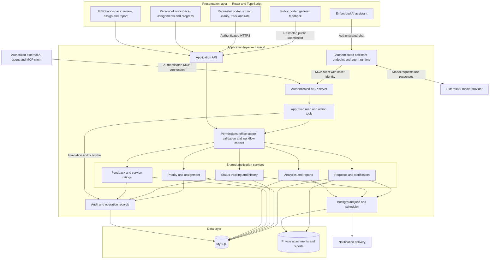

# CLSU Feedback Management System Architecture

Status: Proposed implementation baseline  
Updated: 19 October 2026

## Purpose and scope

This document defines the architecture of the CLSU Feedback Management System and Service Tracker. It guides implementation of service requests, feedback collection, personnel assignments, progress tracking, reporting, and controlled AI agent actions through Model Context Protocol (MCP).

The system uses a React frontend, a modular Laravel backend, and a centralized MySQL database. The application API and MCP tools invoke the same application services so that permissions, validation, and workflow rules remain consistent.

The design follows the supplied ITRM 3100 research draft and the [FEEDBACK MANAGEMENT Figma draft](https://www.figma.com/design/PeQN6nVBQbPNXWoTU32Mhm/FEEDBACK-MANAGEMENT?node-id=0-1). It describes intended behavior, rather than an already implemented system.

## Login routing (implemented prototype)

The landing page has one **Staff login** for administrators and service personnel, alongside requester access through **Request a service**. After successful authentication, the website redirects users according to their assigned account role (their operational position in the system):

| Account role | Entry | Destination |
| --- | --- | --- |
| Administrator (`admin`) | Staff login | `/app/admin` — administration dashboard |
| Service personnel (`personnel`) | Staff login | `/app/work` — assigned work |
| Requester (`requester`) | Request a service | `/app/requester` — personal dashboard |

The server verifies credentials, active-account status, and eligibility for the selected entry. Staff login accepts only administrator or personnel accounts. The role comes from the account record; a URL parameter or a faculty/student classification cannot grant permissions. The shared `/app` route also forwards an existing session to its role's home. Opening an incompatible sign-in entry offers an explicit account switch with logout confirmation. Existing role-specific sign-in URLs remain compatible.

## Technology and architectural approach

For the implemented local Windows prototype, Laravel runs with PHP 8.5 supplied by **Laragon**, and **Composer** installs PHP/Laravel dependencies from `backend/composer.lock`. The React/TypeScript frontend uses Node.js and npm, with dependencies installed from `frontend/package-lock.json`. The project launcher starts Laravel, Vite, and the report queue worker; the local database runs separately on port 3307. This setup opens at `http://127.0.0.1:5173` and does not currently use a Laragon `.test` virtual host. See the README for installation and startup commands.

| Area | Proposed choice | Responsibility |
| --- | --- | --- |
| Frontend | React, TypeScript, Vite | Responsive portals and workspaces |
| Backend | Laravel | API, authorization, validation, business rules, MCP server |
| Database | MySQL | Operational records, history, audit records |
| Files | Private Laravel storage | Attachments and generated reports |
| Background processing | Laravel queues and scheduler | Reports, notifications, defined maintenance tasks |
| Agent connection | Authenticated Laravel MCP server | Approved read and action tools |
| Embedded assistant | Server-side AI runtime and model provider | Chat, model interaction, MCP client execution |

The backend follows a **modular monolithic architecture**: modules share one application deployment and database while maintaining distinct responsibilities. The React frontend communicates with Laravel over HTTPS. Serving both under one domain is preferred to simplify session authentication and deployment.

Exact Laravel, PHP, MCP package, and AI runtime versions must be pinned after compatibility checks. Redis and broadcasting are optional additions based on measured needs.

### Temporary device-hosted public demo (implemented launcher)

The repository includes a Windows launcher for a temporary public synthetic demo, separate from the normal local instance. It builds the React app in `hosted-demo` mode, serves the built SPA and Laravel API on one loopback origin, and connects that origin to an HTTPS Cloudflare Quick Tunnel. A separate queue worker handles exports. It provisions a new MySQL demo database and scoped runtime user, replaces the seed passwords, isolates sessions/cache/private files, and enforces the existing production configuration guard. It does not publish to GitHub Pages or copy the working local database. See [public-demo startup and limits](../README.md#temporary-public-demo-hosted-on-this-pc).

This path uses PHP 8.5 and cloudflared 2026.10.2, including an optional Windows DNS workaround. It is intended for low-volume demonstrations with synthetic data while the PC remains on. A successful tunnel health check is distinct from full browser/workflow verification; evidence for the latter is recorded locally only after the dedicated check succeeds. Continuous hosting, production capacity, final campus policies, and MISO approval remain outside this temporary setup.

## Architecture diagram

The arrows show logical dependencies and calls. Responses return through the calling interface. After a successful change, React refetches the record; polling or broadcast events can refresh other open views.

## User interfaces and access

| Actor | Interface and allowed access |
| --- | --- |
| Public visitor | Submit general feedback with optional contact details; no access to private jobs |
| Authenticated requester | Submit requests, view own records, respond to clarification, evaluate eligible completed jobs |
| Service personnel | View assigned work and record permitted progress updates |
| MISO administrator | Review and route requests within authorized scope, assign personnel, report, and use MCP |
| Connected AI agent | Invoke approved tools within the connected administrator's permissions and tool scopes |

The requesting office and handling office are separate fields. Office membership alone does not grant university-wide access. Student, faculty, staff, visitor, and alumni classifications describe the user; operational roles determine permissions.

Public feedback access follows the mobile Figma flow and remains subject to confirmation of eligibility, moderation, and guest-access rules. Request submission and private tracking require authentication.

## Application modules

| Module | Responsibility |
| --- | --- |
| Identity and access | Accounts, roles, office memberships, record-level policies |
| Request management | Unique job numbers, service details, requester and handling offices |
| Clarification | Messages, requester revisions, resubmission under the existing job number |
| Priority and assignment | Urgency/impact rules, official priority, eligible personnel, assignment history |
| Tracking | Status transitions, timestamps, actions taken, internal and requester-visible updates |
| Feedback and ratings | Independent general feedback and one verified requester evaluation per completed job |
| Reporting | Aggregates, reporting periods, response/resolution metrics, private exports |
| Notifications | Assignment, clarification, progress, and completion notices |
| Audit and agent operations | Actors, changes, reasons, operation identifiers, execution outcomes |

API controllers and MCP tool handlers remain thin. They validate transport inputs, establish caller identity, and invoke application services. Business rules belong in those services and policies rather than being duplicated in the UI or agent prompts.

## Service workflows

### Request and assignment

1. An authenticated requester submits service type, subject, location, affiliation, concern, urgency, and impact.
2. Laravel validates the submission and creates a unique job number.
3. MISO verifies the details, confirms category and handling office, and determines official priority.
4. Eligible personnel are assigned and notified through the normal application workflow.
5. Personnel record progress and actions taken until authorized human staff document completion.
6. The requester may submit one optional service evaluation.

Requester-reported urgency and impact remain separate from official priority. Laravel applies the MISO-approved matrix. Authorized exceptions require a recorded reason. Response targets are configuration to confirm with MISO, rather than assumed deadlines.

### Status rules

| Status | Meaning or prerequisite |
| --- | --- |
| Pending | Received and awaiting review or assignment |
| For Clarification | A recorded clarification request needs a response |
| Assigned | Eligible personnel are assigned |
| In Progress | Work has started and an operational update is recorded |
| On Hold | Work is paused with a reason |
| Completed | Authorized human staff recorded actions taken and the outcome |

Clarification resubmission preserves the job number and revision history. Allowed transitions and prerequisites are enforced on the server. The first-release agent cannot mark a service Completed. A missing client rating does not undo completion.

### Feedback and visibility

General feedback can exist without a service request. A job number entered into a public feedback form is an **unverified reference**. It grants neither private record access nor permission to consume the requester's verified service evaluation.

Internal notes and requester-visible updates have explicit visibility. Requester API responses exclude internal notes. Private attachments require record-level authorization even when someone knows a file identifier or job number.

## Data architecture

| Entity group | Proposed records and relationships |
| --- | --- |
| Organization and access | Users, offices, office memberships, roles, permissions |
| Configuration | Service types, categories, priority rules and applicable versions |
| Service requests | Requester, requesting office, handling office, job number, details, official priority, status, record version |
| Operational history | Multiple assignments, status transitions, clarification messages, revisions, and progress notes per request |
| Feedback | Independent general feedback; zero or one verified requester evaluation per completed job |
| Supporting records | Attachment metadata, notifications, report jobs, agent operations, audit entries |

Use foreign keys and database constraints for valid relationships, unique job numbers, one verified evaluation per job, and operation-identifier uniqueness within its caller/tool scope. Generate job numbers using transactional sequencing or an equivalent concurrency-safe mechanism, rather than counting existing rows.

Every operational write checks the expected record version. A stale action is rejected and returns current state for review. Related data changes and audit entries are saved in a transaction. Notifications are dispatched after commit; workers handle retries and prevent duplicate delivery where feasible.

MySQL holds file metadata. Attachments and generated exports remain in private storage, accessed through authorization checks or short-lived authorized links.

## MCP connection and agent capabilities

MCP exposes application capabilities to a compatible agent host. The host runs the agent/model interaction; Laravel authenticates calls and enforces application rules. An embedded React assistant additionally needs a server-side AI runtime and configured provider.

The first release enables authorized MISO administrators to analyze records and perform explicitly requested operational updates.

| Tool | Capability and boundary |
| --- | --- |
| `search_requests` | Filter and paginate authorized requests; no arbitrary SQL |
| `get_request_details` | Read permitted details, history, and current record version |
| `get_attention_queue` | Return rule-based ranking with urgency, impact, age, and configured deadline evidence |
| `get_personnel_workload` | Return recorded eligibility, availability, and active assignments |
| `get_feedback_metrics` | Return backend-calculated aggregates, period, and sample counts |
| `get_operation_result` | Retrieve the authorized outcome after a timeout or retry |
| `assign_request` | Assign or reassign eligible personnel on explicit instruction |
| `set_request_priority` | Apply configured rules or an authorized documented exception |
| `add_internal_note` | Append an explicitly requested operational note |
| `request_clarification` | Record the specified message, apply its permitted status change, and trigger normal notification |
| `transition_request_status` | Apply permitted operational transitions; exclude completion |
| `request_report` | Queue a standard report with authorized filters |
| `get_report_job` | Read report status and retrieve an authorized result after success |

Laravel calculates ranking inputs and report metrics. The model explains results and recommends actions with supporting job references. Negative sentiment alone does not establish urgency. Recorded availability cannot prove that personnel are physically available.

### Example interaction

> Administrator: Which requests should we work on first?
>
> Agent: Retrieves the attention queue and workload, then explains its recommendations with supporting records.
>
> Administrator: Assign the selected request to Mark and add this internal note.
>
> Agent: Calls the assignment and note tools. Laravel verifies authority, eligibility, current versions, and workflow rules, then returns the actual results.

An analysis question does not authorize changes. An explicit update instruction authorizes only the specified action. Assignment and note creation are separate operations unless an explicit transactional tool is implemented; a partial failure must be reported accurately.

### Tool execution contract

Read tools use bounded filters, pagination, and minimal fields. Write tools accept a target identifier, validated action parameters, expected record version, operation identifier, and reason. Caller identity comes from server authentication, never a model-supplied user identifier.

Each write stores its operation identifier and input fingerprint. Repeating the same operation returns its recorded result; reusing the identifier with different inputs is rejected. Results identify affected records, resulting versions, and actual execution state. Permission denial, invalid input, invalid workflow, stale version, and temporary failure have distinct errors.

A queued report is accepted rather than completed. The agent checks job status before claiming the export is ready. If a write times out, it retrieves the recorded outcome before deciding whether to retry.

## Security and first release boundaries

Protect remote MCP access with HTTPS and supported authentication. A controlled pilot can use revocable scoped user tokens; external multi-user connections should use a compatible OAuth flow. Every tool checks user permissions, office scope, tool scope, and record access.

If an action requires separate confirmation, Laravel verifies an approval bound to the exact user, target, parameters, record version, and expiry, and consumes it once. Host prompts and tool annotations do not replace server authorization. Approval records must originate through a trusted authenticated flow, rather than an agent marking its own action approved.

The first release excludes:

- Arbitrary SQL, shell commands, unrestricted database access, and application code changes.
- Account, role, permission, and system-configuration administration through MCP.
- Deletion or alteration of original requester statements, client ratings, and audit history.
- Agent-driven service completion or invented work outcomes.
- Unattended bulk reassignment or reprioritization.
- Arbitrary outbound email, unrestricted exports, and continuous autonomous monitoring.

These exclusions are product scope decisions, not inherent limitations of Laravel.

Treat submitted feedback, request descriptions, and attachments as untrusted content. They cannot authorize tool calls. Apply public-submission and MCP rate limits, validate attachments, minimize data sent to external models, and exclude credentials and unnecessary contact details. Provider data handling and retention must be agreed with MISO before personal data is processed externally.

Audit records capture the authorizing user, connected agent/client, operation identifier, target, previous and resulting values, timestamp, reason, and execution outcome. Avoid logging credentials or unnecessary sensitive content.

## Deployment and operational behavior

Deploy the React build and Laravel application under one HTTPS domain where practical, with MySQL, private storage, a supervised queue worker, and a scheduler. A database-backed queue can be sufficient initially if validated by testing. Large exports and lengthy AI tasks run as background jobs.

External agents need network access to the MCP endpoint. A campus-only server requires an approved network path from the chosen agent host. Provider calls require outbound connectivity. Connecting a client does not create an always-running monitoring agent.

React refetches affected records after successful actions. Initial cross-session updates can use polling; broadcasting can be introduced when needed. Database changes do not automatically update an open browser.

| Failure | Required behavior |
| --- | --- |
| AI provider or MCP unavailable | Ordinary request, assignment, tracking, and feedback workflows continue |
| Tool timeout after submission | Retrieve the operation outcome before retrying |
| Concurrent record change | Reject stale write and refresh current details |
| Report still processing | Return job identifier/status; provide download only after success |
| Worker or notification failure | Record failure, use bounded retries, and expose operational status |

Configure connection timeouts, request timeouts, retry limits, worker supervision, and job monitoring. Keep provider secrets outside the frontend and repository. Define database and file backups together and test restoration. Capacity claims require load testing; the paper's server specification is a planning baseline.

## Verification criteria

| Area | Required evidence |
| --- | --- |
| Lifecycle | Submit, clarify, assign, track, complete, and optionally evaluate a request |
| Permissions | Cross-user and cross-office access attempts fail through API and MCP |
| Priority and reporting | Matrix rules, time calculations, denominators, and rating counts match expected results |
| Agent actions | Explicitly authorized updates persist; excluded operations remain unavailable |
| Integrity | Stale versions fail and repeated operation identifiers do not duplicate changes |
| Privacy | Internal notes and files remain restricted; injected instructions cannot grant authority |
| Resilience | Provider failure leaves core workflows usable and background failures remain traceable |
| UI synchronization | Agent changes appear after refresh or an implemented update event |

## Decisions requiring MISO validation

Before production use, confirm public feedback eligibility and moderation; guest access; the urgency/impact matrix and response targets; handling-office responsibilities; allowed status transitions; report periods and business-hour definitions; provider data handling; retention and backup policies; and hosting/network arrangements.

The manuscript must align its scope with third-party AI integration and distinguish MCP from the language model. Exact framework/package versions and supported client authentication/transport combinations must be validated during implementation.

## References

- Research reference: supplied `ITRM 3100.md`, Development and Enhancement of Web Based Feedback Management System and Tracker for CLSU Services.
- [Figma system flow draft](https://www.figma.com/design/PeQN6nVBQbPNXWoTU32Mhm/FEEDBACK-MANAGEMENT?node-id=0-1).
- [Laravel MCP documentation](https://laravel.com/framework/docs/13.x/mcp).
- [Laravel AI SDK documentation](https://laravel.com/framework/docs/13.x/ai-sdk).
- [Laravel authorization documentation](https://laravel.com/framework/docs/13.x/authorization).
- [Laravel queues documentation](https://laravel.com/framework/docs/13.x/queues).

Framework documentation reviewed 19 October 2026. Application-specific controls in this document require implementation and testing.

## Implemented service evaluation reports · 20 October 2026

The prototype now has office-scoped staff categories, calendar-month/rolling summaries, and queued private PDF/Excel/CSV exports. `ServiceEvaluationReport` shares aggregation rules between the authenticated report-summary endpoint and `GenerateReport`; `ReportRenderer` formats the snapshot. Category creation and category review use shared services. Report downloads reauthorize the requesting administrator and handling office and require a successfully stored file. UI polling distinguishes accepted, processing, completed, failed and unavailable results. No MCP tool, scheduled delivery or human workflow bypass is added. See [implemented definitions](implementation-notes.md#service-evaluation-reporting-implemented-on-20-october) for cohort, assignee, rating, elapsed-hour and recurring-subject rules.
